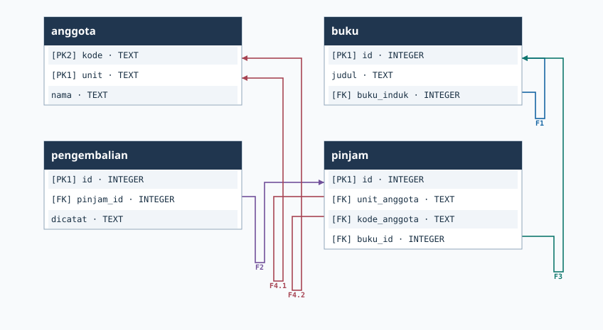

# PetaRelasi

PetaRelasi membuat ERD dengan panah yang menempel pada baris kolom foreign key dan kolom tujuannya. Sumbernya dapat berupa database SQLite atau snapshot JSON. Buka keluaran Draw.io untuk menyunting diagram, atau gunakan SVG untuk pratinjau.



## Fitur

1. **Ambil snapshot skema.** Baca nama tabel, kolom, primary key, dan foreign key dari SQLite dalam mode baca-saja.
2. **Buat diagram per kolom.** Setiap pasangan kolom mendapat konektor dan panah tujuan sendiri. Pasangan dari satu foreign key gabungan memakai nomor grup yang sama, misalnya `F4.1` dan `F4.2`.
3. **Fokus pada tabel tertentu.** Atur jarak relasi agar diagram besar bisa dibagi menjadi bagian yang lebih mudah dibaca.
4. **Ekspor Draw.io dan SVG.** Keduanya memakai tata letak deterministik dan jalur siku yang disediakan di sela tabel.

## Instalasi dan demo

Gunakan Python 3.10 atau lebih baru. Ekstrak ZIP dan buka terminal di folder yang berisi `pyproject.toml`. Program memakai pustaka standar dan SQLite bawaan Python.

```powershell
python -m petarelasi demo contoh-baru
python -m petarelasi render contoh-baru/skema.json fokus.drawio --focus anggota --radius 1
```

```text
4 tabel, 5 sambungan kolom. Hasil di contoh-baru.
2 tabel, 2 sambungan kolom. Hasil di fokus.drawio.
```

Demo membuat `perpustakaan.sqlite`, `skema.json`, `erd.drawio`, dan `erd.svg`. Buka `erd.drawio` melalui **File → Open From → Device** di diagrams.net atau Draw.io Desktop. Gunakan penampil SVG untuk melihat `erd.svg`.

Untuk SQLite sendiri, jalankan perintah berikut dari folder proyek.

```powershell
python -m petarelasi snapshot database.sqlite skema.json
python -m petarelasi render database.sqlite hasil.drawio
python -m petarelasi render skema.json hasil.svg
```

Gunakan nama keluaran baru. `--focus` memakai nama tabel sesuai snapshot. `--radius` bernilai 0–5 dengan bawaan 1. Radius 0 menyisakan tabel pusat dan relasi ke dirinya sendiri. Radius 1 menyertakan tabel yang berhubungan langsung dari kedua arah. Relasi ditampilkan jika kedua tabelnya termasuk dalam tampilan.

## Format snapshot

Snapshot bisa disiapkan secara manual untuk skema di luar SQLite. Berikut bentuk minimalnya.

```json
{
  "version": 1,
  "tables": [
    {"name": "anggota", "columns": [{"name": "id", "type": "INTEGER", "pk": 1}]},
    {"name": "pinjam", "columns": [{"name": "anggota_id", "type": "INTEGER", "pk": 0}]}
  ],
  "foreign_keys": [
    {"table": "pinjam", "columns": ["anggota_id"], "references": "anggota", "ref_columns": ["id"]}
  ]
}
```

`pk` bernilai 0 untuk kolom biasa, 1 untuk bagian pertama primary key, dan seterusnya. Posisi di `columns` dipasangkan dengan posisi yang sama di `ref_columns`. Nama tabel dan kolom pada relasi harus cocok dengan definisi snapshot.

## Jaminan dan batas

**Sambungan mengikuti nama dan urutan kolom dalam skema.** Foreign key gabungan yang hanya menyebut tabel induk di SQLite dipasangkan dengan urutan primary key induk. Setiap garis Draw.io menunjuk ID baris sumber dan tujuan yang terpisah. SVG menempatkan titik ujung berdasarkan geometri baris tersebut. Input dengan tabel atau kolom tujuan hilang ditolak sebelum keluaran ditulis.

Tabel diurutkan menurut nama dan ditempatkan hingga empat per baris. Jalur memakai lajur vertikal di sisi tabel dan lajur horizontal di sela baris. Jalur hasil generator SVG tidak melewati bagian dalam kotak tabel. Persilangan antargaris masih bisa terjadi pada skema padat. Draw.io dapat menghitung ulang jalur saat pengguna memindahkan elemen. Input skema ekuivalen menghasilkan byte diagram yang sama selama urutan kolom tiap tabel dan pasangan foreign key tetap sama.

Cakupan alat adalah struktur relasi. Pemeriksaan isi record, pelanggaran data, pembacaan DDL PostgreSQL, dan optimasi tata letak global berada di luar cakupan. Satu snapshot dibatasi hingga 48 tabel, 600 kolom, 100 foreign key, dan 120 pasangan kolom. Program mengembalikan kode 0 jika berhasil dan 2 jika input atau keluaran tidak bisa diproses.

| Berkas | Tanggung jawab |
| --- | --- |
| `petarelasi/schema.py` | Introspeksi SQLite, validasi JSON, dan pencarian tetangga tabel. |
| `petarelasi/layout.py` | Posisi tabel, port per baris, dan lajur untuk sambungan. |
| `petarelasi/render.py` | Serialisasi Draw.io XML dan SVG. |
| `petarelasi/__main__.py` | CLI, demo, serta penulisan keluaran. |
| `tests/test_integration.py` | Tes CLI, pemetaan foreign key, dan geometri. |

Rujukan struktur konektor dan aturan foreign key tersedia di [dokumentasi Draw.io](https://www.drawio.com/docs/reference/diagram-generation/) dan [dokumentasi SQLite](https://www.sqlite.org/foreignkeys.html).

## Tes

```powershell
python -m unittest discover -s tests -v
```

Tes memeriksa foreign key gabungan, relasi ke tabel sendiri, nama dengan karakter khusus, hasil deterministik, dan penolakan skema dengan target yang hilang. Uji XML memeriksa ID baris yang dipakai konektor dan uji geometri memeriksa jalur terhadap kotak tabel.
